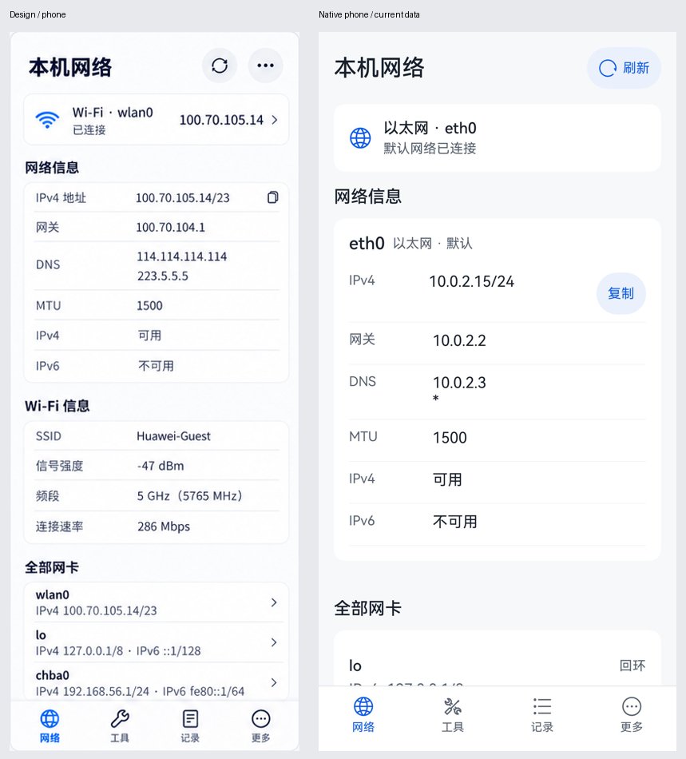
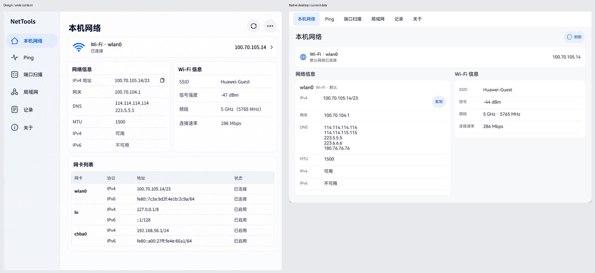
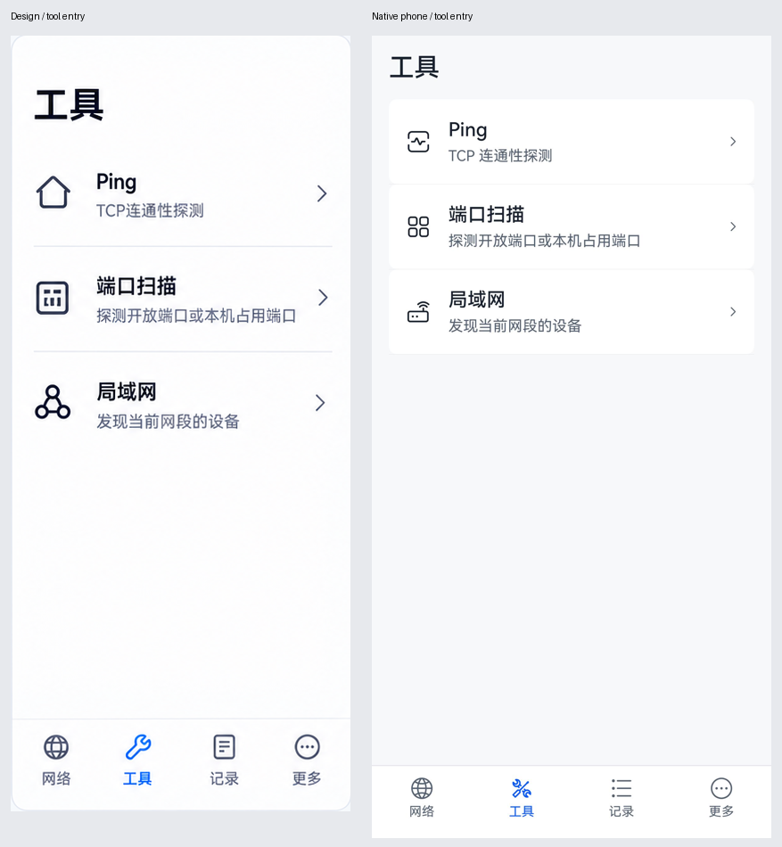
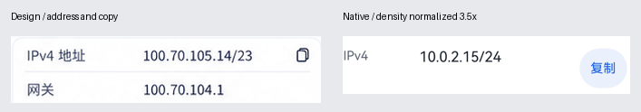

# UI 改造阶段1：设计对照与验证

后续全页面实施和最新验证见[阶段2—3报告](docs/ui-verification/phase2-3/README.md)；本页保留阶段1的范围与原始证据。

日期：2026-10-22。范围限定为导航壳、工具入口、基础控件及本机网络页；不是整套应用验收。

## 设计依据与证据

- 规范：`docs/ui-redesign-2026-10-22/UI-SPEC.md`，尤其图稿校正项。
- 源图：`assets/01-local-network.png`、`assets/08-tools.png`，位于上述归档目录，均1448×1086px，包含两个示意视口和说明带，不是精确设备像素截图。
- 手机实现：`docs/ui-verification/phase1/phone-final.jpeg`（1320×2856px，OpenHarmony API24模拟器）。去掉系统状态／手势区后见`phone-content.png`。44vp按钮对应约154px，密度约3.5；内容宽约377vp。使用真实以太网数据，无Wi-Fi，不能伪装成源图Wi-Fi示例。
- 电脑实现：`docs/ui-verification/phase1/pc-final.jpeg`（3120×2080px，MateBook API26真机），窗口2090×1394px；移除系统装饰和背景后见`desktop-content.png`（2090×1324px）。44vp约84px，密度约1.9；应用内容宽约1100vp。源图为平板侧栏，电脑按规范改顶部导航，不将此差别视作错误。
- 所有截图为亮色。比较图按比例缩放以便并排阅读，不强行拉伸源图到设备尺寸，也不声称像素级一致。

合并比较输入：

局部图把实现按约3.5倍密度归一；其余合并图用于结构和可读性对照，不作像素尺寸断言。源图的箭头／小字号不覆盖文字规范的44vp和16fp要求。

## 发现、修复与复查

- [已修复/P2] 初次截图`shots/ui-phase1-phone.jpeg`和`shots/ui-phase1-pc.jpeg`中，数据已经显示，但页头仍显示禁用的“刷新中”。原因是组件入参未声明响应式Prop。为UiPageHeader及UiAction的动态文案／启用值增加`@Prop`，ErrorBanner消息同样处理。重新构建、安装、截图；最终手机和电脑图中的“刷新”均已正常恢复。
- [已修复/P2] 旧窄屏六项导航字号小且缺少明确工具入口。本阶段已改成四项图标文字底栏，工具页三个真实入口；点击和返回均实际验证，最后图为新状态。
- [按规范接受] 手机网卡信息因真实数据、字号和最小行高超出首屏，允许滚动；`ifaces.jpeg`显示长IPv6和底部导航均可读，没有整页横向滚动。电脑真实DNS有5项，参数区高于仅2项的源图，网卡表在下方滚动区；不删数据迎合示例。
- [按规范接受] 源图部分不真实的网卡／连接详情箭头、首页更多菜单删除；工具入口箭头保留。复制按钮使用文字和原生反馈，扩大点击区。

## 五项视觉检查

| 项目 | 本阶段结果 |
|---|---|
| 字体 | 系统字体，页名24fp，正文16fp，辅助14fp；底栏12fp；没有把IPv6强制压成小字 |
| 布局 | 窄屏单列；电脑网络参数／Wi-Fi双列、网卡在下；原生按钮可聚焦，复制操作至少44vp |
| 色彩 | 迁移区域使用语义资源和base/dark资源；已检查亮色，深色实机视觉未验收 |
| 资产 | SDK系统符号；Ping使用连通性符号，不照抄源图的房屋图标；没有栅格化UI或自绘假图标 |
| 文案 | 实际网络地址、DNS、Wi-Fi和接口数据；连接不等于互联网可达；没有实现名和内部网络编号 |

## 功能证据

- 应用构建及ohosTest构建通过。
- MateBook真机执行9个单元测试：9通过、0失败、0错误。新增3项覆盖Wi-Fi局部失败保留网络、刷新失败保留旧数据且可重试、重复刷新不产生并发请求；其余6项为既有子网与导出序列化。
- 手机：工具入口→Ping→输入127.0.0.1→持续探测→返回工具，显示离开确认；取消后“停止”按钮仍存在，任务保持运行；再次返回并确认后进入工具页，重新进入Ping保留目标127.0.0.1。弹窗截图见`leave-dialog.jpeg`。本次仅验证导航，Ping控件视觉仍待阶段2。
- 电脑：窗口由2090px缩为1396px，输入框`118:247`的宽度由1916px变为1222px，实例标识和文本127.0.0.1未改变。实际验证输入状态没有因窗口变形丢失；未声称验证全部运行中任务的横竖屏场景。
- 依赖目录中迁移前的失效junction由`ohpm install --all`修复，不修改依赖版本。

## 待后续阶段验证

平板真机／折叠或分屏触屏分支、深色视觉、大字体、读屏、键盘完整路径、复制成功反馈、扫描页全流程及记录操作，仍在整体计划阶段2–4内。它们不在本次局部通过结论中。其余页面当前仍有旧配色／字号，不能对外描述为全界面改造完成。

P3：工具入口分组外观还可进一步收敛圆角；系统符号外形与位图不同，以平台可用资源为准。

final result: passed

此结果仅针对上述已验证的阶段1手机／电脑范围，不表示平板或完整UI通过验收。
