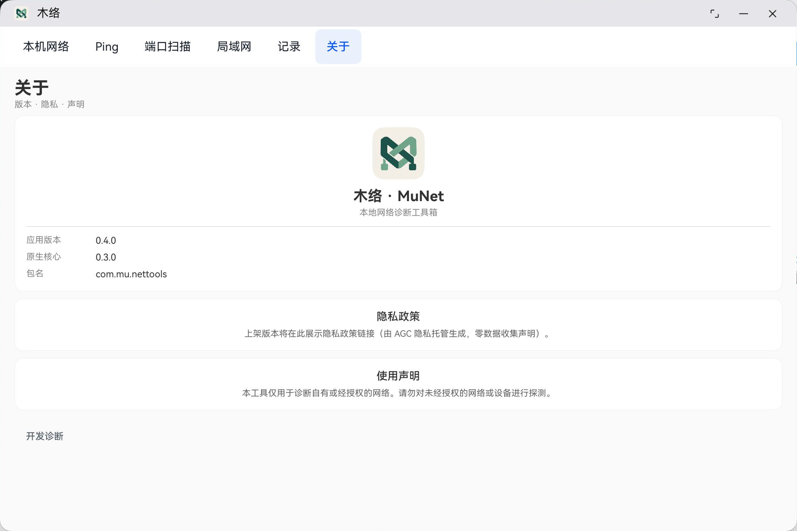

# 木络 · MuNet：品牌资源

2026-10-22。用户已确认接入，应用显示名称为木络，英文资源为MuNet，应用内品牌为木络 · MuNet。

中文延续“木＋单字”的系列风格，“络”对应网络和连接；英文用MuNet，与Mu系列命名衔接。

方向：木构榫接与网络连接形成抽象M形标记；深松绿、浅玉绿配暖瓷白底。图中不放文字，不预先切成系统圆角。

## 已接入位置

- AppScope应用图标：`app_layered_image.json`，透明前景`munet_foreground.png`＋纯色背景`munet_background.svg`。
- EntryAbility桌面入口：原`layered_image.json`改为引用同一套前景／背景，不再使用旧蓝色资源。
- 启动图：`startIcon.png`使用原稿，启动背景与暖瓷白底一致。
- 应用内：侧栏名称、关于页名称和72vp图标。
- 中文显示名木络，英文显示名MuNet；包标识和数据库不因展示品牌变化而迁移。

原稿和透明前景均为1254×1254px，前景含真实alpha通道。素材源文件不等同于应用市场提交尺寸；上架前另按AGC当时校验要求导出，详见[准备记录](RELEASE-PREPARATION.md)。

## 验证

应用构建、签名和覆盖安装通过。MateBook真机确认系统窗口／任务栏图标和名称更新，关于页显示新图标和木络 · MuNet。手机模拟器已安装，前台被其他应用占用，没有用无关页面冒充手机桌面验收。

此次仅接入品牌，扫描页、记录和关于布局仍沿原改造计划推进；不把此品牌变更当成全界面改造完成。

工具：内置Image Gen。[原稿生成提示词](PROMPT.md)，[透明前景提取提示词](FOREGROUND-PROMPT.md)。背景SVG仅定义纯色，不重绘图标主体。
