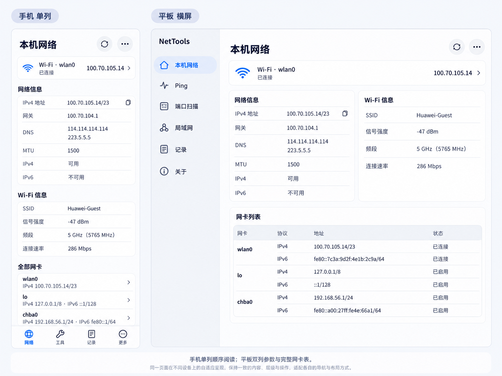
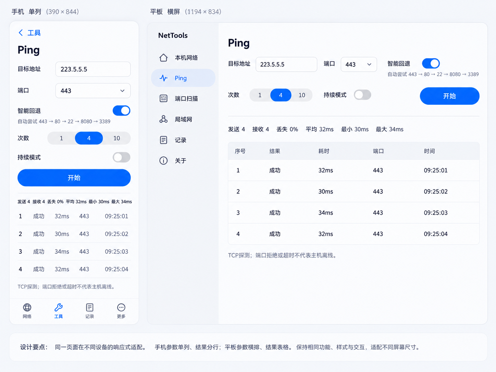
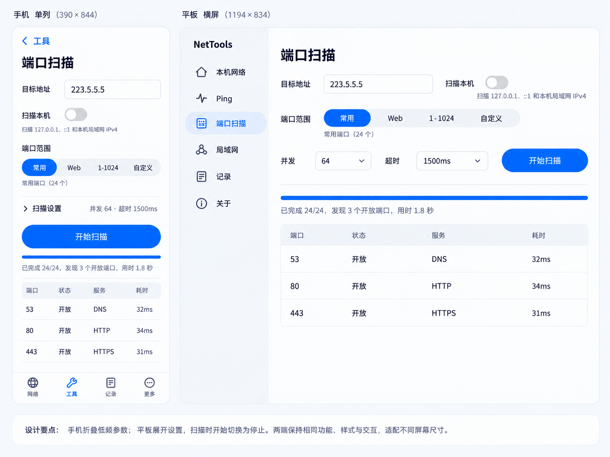
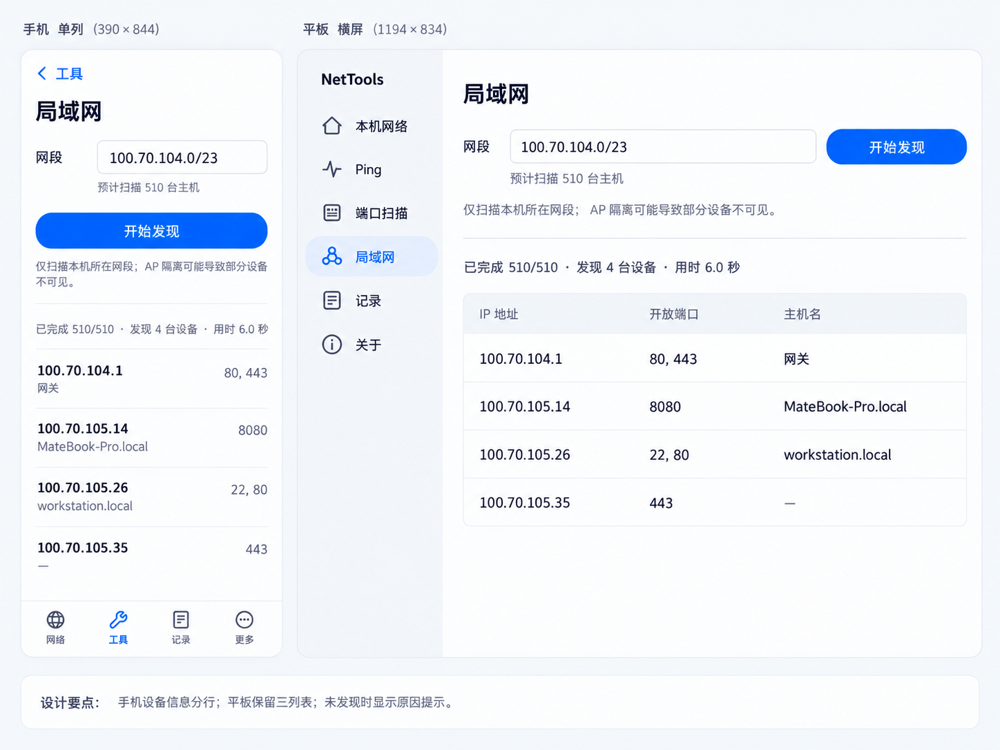
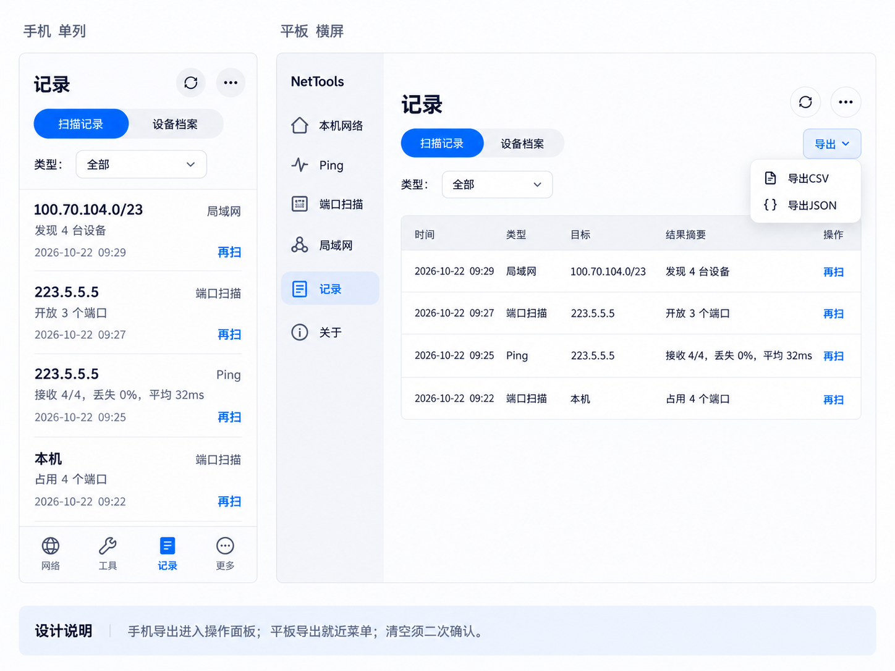
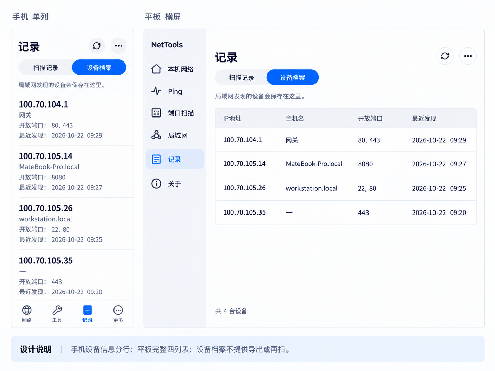
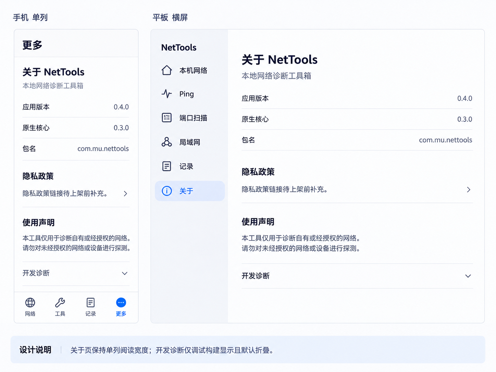
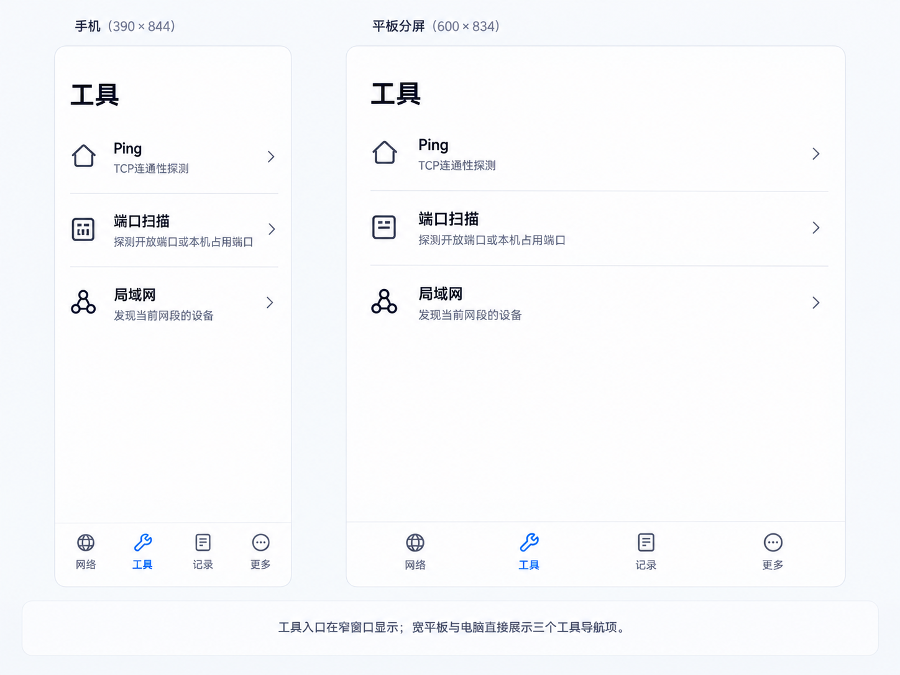
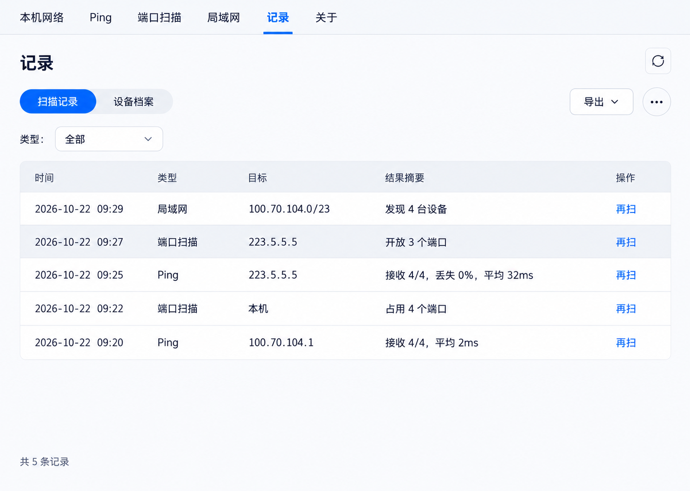

# 木络 MuNet 设计图册

以下为同一套设计的响应式对照，不是互斥方案。图中数据用于示意排版，不是新一轮扫描实测。图稿中的字号和尺寸标注表达逻辑尺寸，图片本身可能按比例渲染；不要从位图像素反推 vp。

## 01 本机网络

## 02 Ping

## 03 端口扫描

## 04 局域网

## 05 扫描记录

## 06 设备档案

## 07 关于／更多

## 08 工具入口

## 09 电脑记录页参考

电脑的六个主页面使用相同顶部导航和宽屏内容规则；手机、平板页面行为详见 [完整设计规范](UI-SPEC.md)。
