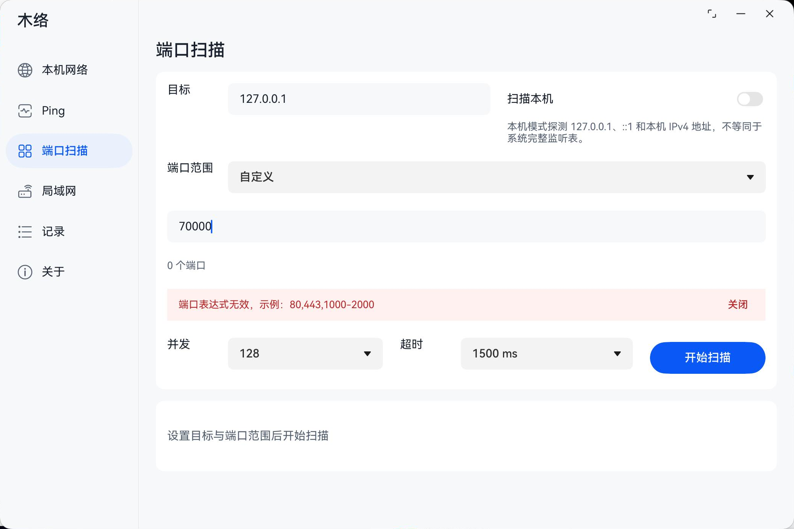
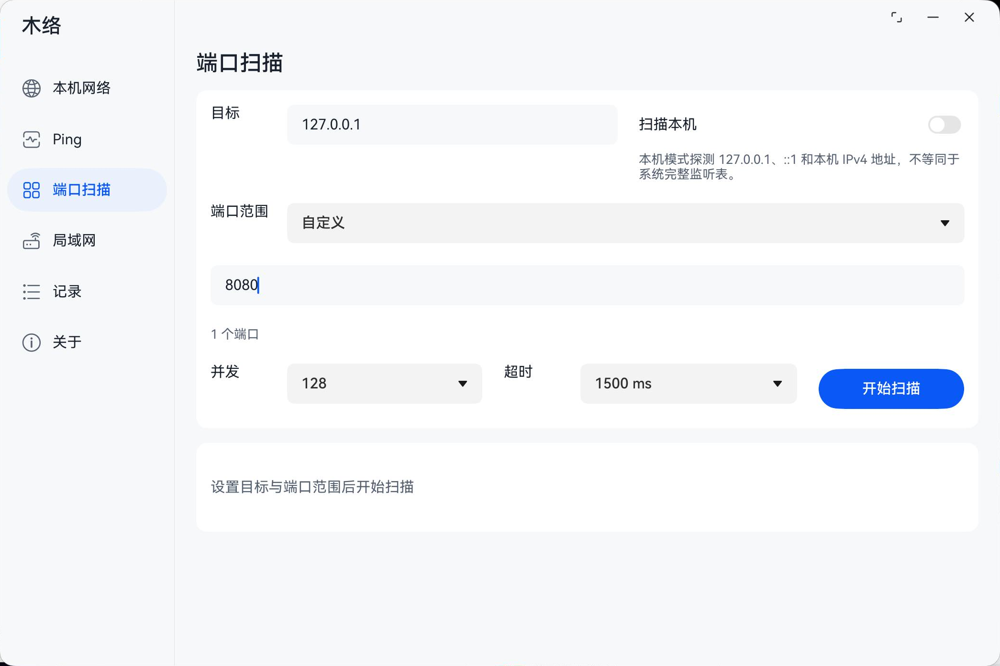

# 木络产品化检查与上架准备

2026-10-23，基线提交`b462adc`。结论：**可以进入上架准备，暂不能直接送审。** 两处代码问题已修复并验证；正式发布身份、隐私配置、账号资料和正式包质量验证仍缺少证据。

开发者优先看[申请与资料清单](USER-ACTIONS.md)；可直接审阅[商店文案草稿](STORE-LISTING.md)与[隐私数据清单](DATA-MAP.md)。本轮没有登录开发者中心、上传、创建发布单或提交审核。

## 产品检查结果

| 项目 | 结果／处理 |
|---|---|
| 功能与宣传边界 | 保留本机网络、TCP Ping、端口扫描、局域网、记录、设备档案及CSV／JSON；不宣传ICMP、加速、流量统计、MAC识别或完整监听表 |
| 导航、窗口与键鼠 | 基线的全页与六档窗口证据见[阶段10](../../verification/phase10/README.md)，触屏见[阶段9](../../verification/phase9/README.md)。这两份是其当时源码的验收，不能冒称新候选重新跑了整套UI矩阵 |
| 端口输入纠错 | 原先70000报错后改为8080，旧错误仍显示。现在空闲时编辑表达式／目标立即撤除旧提示，开始时仍重新校验；不自动启动扫描。实机复现与修正后截图见下 |
| CSV文本安全 | 仅双引号转义不能阻止表格公式识别。对ASCII／全角公式前缀、前导空白及制表／换行开头文本补单引号，仍保留CSV引号转义；JSON保留原值。新增回归覆盖这些输入及普通中文目标 |
| 数据与网络行为 | 已核对沙箱记录、500条保留上限、设备档案、导出全部记录／取消、用户发起的TCP／DNS／mDNS、系统剪贴板；见隐私数据清单 |
| 第三方依赖 | 依赖声明无第三方广告／遥测运行SDK；自有native库＋系统Kit，测试依赖不在Release。源码检查不是专用安全扫描或隐私检测报告 |
| 声明权限 | 仍只有INTERNET、GET_NETWORK_INFO、GET_WIFI_INFO；本次不增加ACL、定位或全盘访问 |
| Release包 | debug=false、版本、权限、双ABI、字节码、无测试模块等检查通过；尚无正式发布证书／Profile |
| 关于页 | 继续保留基础介绍；没有重新增加版本、标识或隐私占位段落。商店隐私声明／标签仍需真实配置 |

CSV处理是降低误执行风险的文本防护，不是所有表格软件／导入配置／另存再打开情况下的安全保证。需要无损原值时使用JSON；本轮没有在Excel／WPS执行或复存恶意公式。依据：[OWASP CSV Injection](https://community.owasp.org/attacks/CSV_Injection)。

## 本轮验证

| 环境 | 新候选验证 |
|---|---|
| MateBook真机，API26 | **16/16，Failure 0、Error 0**：[日志](matebook-unit-tests.txt) |
| 手机模拟器，API24 | **16/16，Failure 0、Error 0**：[日志](phone-unit-tests.txt) |
| 平板模拟器，API24 | **16/16，Failure 0、Error 0**：[日志](tablet-unit-tests.txt) |
| Release／测试构建 | 通过：[Release](release-build.txt)／[测试](test-build.txt) |
| 源码和候选产物核对 | 通过：[运行文件SHA](release-manifest.json)／[测试及资料SHA](verification-manifest.json) |

16项为同一套测试在三端重复运行，不是48项独立用例。新增用例验证非法端口不启动、输入改正后撤除旧提示并可重试，以及CSV高风险文本处理与JSON原值保留。首次新增测试样例缺少ScanRecord.id导致测试模块编译失败，补齐样例字段后最终构建通过；不是忽略错误或放宽类型。

另在MateBook实际输入70000→点击开始→看到局部校验，再改8080，确认输入保留、端口数为1、旧错误移除、按钮仍为“开始扫描”。未对外发起扫描，未清空数据。

## 候选产物

- `artifacts/release/0.4.0/munet-0.4.0-20261023-store-prep-unsigned.app`
- `artifacts/release/0.4.0/munet-0.4.0-20261023-store-prep-unsigned.hap`

两者为最新未签名Release候选，0.4.0／1000004。三台设备安装使用设备绑定的本地调试Profile，仅供验证；没有得到正式市场签名。历史PC候选与归档不覆盖。正式包到位后必须再核对包名、APP ID、证书、Profile、版本和更新路径，不能直接把本地调试身份的覆盖升级当成市场升级证据。

## 送审前的阻塞项与质量边界

1. **签名与版本身份**：待真实AGC APP ID、已上传最大版本、正式发布证书／Profile；当前build-profile没有发布签名配置。
2. **隐私与主体资料**：待主体、客服／隐私邮箱和政策有效页面／托管配置；隐私标签需按实际行为填写，首次告知、必要同意时机及应用内可访问入口还需按最终政策／审核要求落实。未擅自新增无依据的首启弹窗。
3. **地区、设备与资质**：待首发地区、价格、设备范围、APP备案及按类目要求的资质／权属资料。纯工具的适用要求不能由代码推断，需在该应用AGC页面确认。
4. **正式包质量证据**：应补官方上架测试或等效的兼容、稳定、性能／功耗和隐私检查；当前缺API22、手机／平板真实Wi-Fi与局域网兼容性、正式证书安装／升级、完整读屏及专项安全扫描证据。当前本地用例通过不代替这些项目。
5. **商店公开素材**：用正式版本、授权演示数据重拍。现有内部验收图包含SSID、地址和测试记录；设计图与修复前图不可作为最终宣传图。具体格式、尺寸、数量按实际上传表单校验。

其中隐私、签名、资质是送审资料门槛；上述质量补验是本项目的发布要求，不是声称华为一律强制每个应用跑某个命名测试。华为官方亦明确，上架测试通过不能保证审核通过。[官方上架测试说明](https://developer.huawei.com/consumer/cn/doc/doccenter-testing/agc-help-cloudtest-releasetest-0000002289646673)。

官方核对入口：[应用市场分发](https://developer.huawei.com/consumer/cn/appgallery/devstart/)、[提交HarmonyOS应用](https://developer.huawei.com/consumer/cn/app/submit/)、[发布签名FAQ](https://developer.huawei.com/consumer/cn/doc/doccenter-testing/agc-help-cloudtest-faq-0000002255036920)。官网部分正文抓取超时，实际账号字段与资格以开发者中心校验为准。
