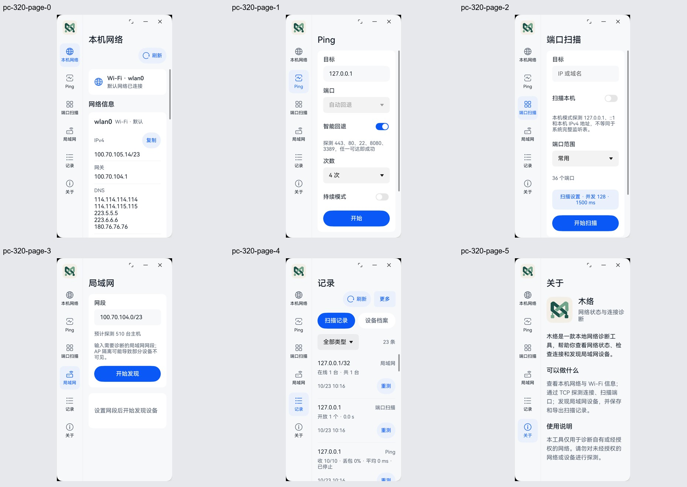
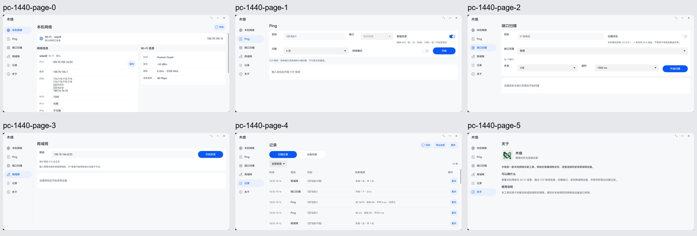

# 阶段10：MateBook末版设计、窗口与键鼠验收

2026-10-23。设备为真实MateBook Pro（HAD-W32，API 26，3120×2080px，density约1.9），不是模拟器。运行0.4.0／1000004、debug=false的Release主模块，测试模块独立安装。没有卸载或清空用户数据。正式市场签名、上传与送审不在本轮范围。

依据[冻结设计规范](../../ui-redesign-2026-10-22/UI-SPEC.md)、图01–09，以及优先于旧规范的[补充决定](../../UI-DESIGN-UPDATES.md)：PC左右分栏；窄窗72vp／宽窗192vp侧栏；首页无MuNet；关于只保留基础介绍，不恢复版本、标识、隐私段落或Release诊断。

## 本轮结果

本报告列明的PC项目通过。修复PC窄窗记录误用手机Sheet的问题，并重新构建、签名、安装复验。以下截图来自本轮实机，不使用旧阶段截图作为新版本证据。

| 最终检查 | 结果 |
|---|---|
| Release与测试模块构建 | 通过：[Release日志](release-build.txt)／[测试日志](test-build.txt) |
| 六档窗口＋短窗＋键鼠＋真实回环综合专项 | **15/15，Failure 0、Error 0**：[日志](pc-final-tests.txt) |
| 深色320／1440vp七页专项 | **15/15，Failure 0、Error 0**：[日志](pc-dark-tests.txt) |
| 最大字体320／1440vp七页专项 | **15/15，Failure 0、Error 0**：[日志](pc-large-tests.txt) |
| Release产物与源码一致性 | 通过，实际双ABI、debug=false、三项权限、无测试模块：[清单](release-manifest.json) |

首次旧脚本的基础专项也15/15通过，见[基线](pc-baseline-tests.txt)。扩展键盘检查后的第一次执行14/15，其原因与修正见下文和[原始失败日志](pc-before-focus-wait-tests.txt)，不隐去失败后只报通过。

## 逐页设计对照

| 步骤 | 页面 | 检查与证据 |
|---|---|---|
| 1 | 本机网络／图01 | 左侧导航，右侧标题与刷新，宽窗网络参数／Wi-Fi双列，窄窗单列；地址与DNS换行，数据来自实际网络。无自绘标题栏、无MuNet横幅。[对照](compare-0.jpg) |
| 2 | Ping／图02 | 通过。宽窗两行参数、原生端口／次数Select、自动回退显示、摘要及结果；窄窗参数纵排，开始按钮可滚达；TCP语义与说明保留。[对照](compare-1.jpg)／[实际结果局部](pc-keyboard-results-detail.png) |
| 3 | 端口扫描／图03 | 宽窗目标与本机开关并排、设置与开始同排，窄窗扫描设置折叠；真实回环服务8080开放，不抄图稿的端口数和耗时。[对照](compare-2.jpg)／[结果](pc-port-results.png) |
| 4 | 局域网／图04 | 宽窗网段和开始同排、结果三列；窄窗纵排。实际127.0.0.1/32发现1台与8080；未知主机名为—。[对照](compare-3.jpg)／[结果](pc-lan-results.png) |
| 5 | 扫描记录／图05、09 | 通过。宽窗局部分段与五列表，窄窗多行记录；导出说明包含全部记录；修正PC窄窗的弹层形态，保持锚定原生菜单。[对照](compare-4.jpg)／[完整菜单局部](pc-narrow-menu-detail.png) |
| 6 | 设备档案／图06 | 四列／窄窗多行；不显示类型筛选、导出或重测。记录与档案切换可用，保留实际发现时间。[对照](compare-hosts.jpg)／[实测档案](pc-hosts.png) |
| 7 | 关于／图07及最新要求 | 仅木络名称、基础介绍、功能及使用说明；最大阅读宽度840vp。六档均断言没有应用版本、标识、核心版本、隐私说明与诊断入口。[对照](compare-5.jpg) |

图08为手机／窄触屏工具入口，PC直接从侧栏进入工具，因此不增加电脑工具中间页。图09的顶部导航已被用户的左右分栏决定覆盖；图07版本等字段已被最新精简要求覆盖。生成图外框、示例地址与时间不属于应用像素要求。原生Select与Button沿用既有同语义实现，不以图稿中的装饰性分段外观替换平台控件。对照图展示结构和实际数据差异，不宣称逐像素一致。

## 六档真实窗口与短窗

| 请求宽度 | 实际内容宽度 | 导航宽度 | 本轮六页截图 |
|---|---|---|---|
| 320vp | 320vp | 72vp | [320](contact-320.jpg) |
| 390vp | 390vp | 72vp | [390](contact-390.jpg) |
| 600vp | 600vp | 72vp | [600](contact-600.jpg) |
| 834vp | 834.21vp | 72vp | [834](contact-834.jpg) |
| 1194vp | 1194.21vp | 192vp | [1194](contact-1194.jpg) |
| 1440vp | 1440vp | 192vp | [1440](contact-1440.jpg) |

每档高度620vp，真实调用窗口resize，日志同时保存窗口／内容边界与density；断言实际宽度与请求差小于2vp、导航始终在左、无手机底栏、输入保留且在窗口边界内。不是图片缩放，也没有将系统限宽算作精确覆盖。设备档案子页在每档另外检查。

834.21×360vp短窗：滚动内容后开始按钮完整可达；用鼠标滚轮滚动左侧导航，再进入关于。[开始按钮](pc-short-ping.png)／[短窗关于](pc-short-about.png)。运行中1440→600→1440vp，目标和任务保持，参数禁用，停止后保留结果。[运行中窄窗](pc-narrow-ping-running.png)。

## 修复与键鼠检查

1. **PC窄窗记录菜单形态错误**：记录页将内容宽度同时用于表格与弹层判断，PC缩窄后弹出手机底部Sheet。[修复前](01-narrow-menu-before.png)。现PC窄窗“更多”绑定原生锚定菜单；扫描记录下提供CSV／JSON和清空，设备档案下仅清空。手机／平板窄窗Sheet保留。[完整菜单](pc-narrow-menu-detail.png)。
2. **测试对焦点回传判断过早**：扩展检查初次在Esc后立即读取isFocused，菜单关闭动画尚未完成，综合用例14/15。失败现场已出现导出按钮焦点框，[现场](pc-keyboard-failure.png)。测试增加600ms等待后重新完整执行，不改变产品焦点行为、不删除断言。

键鼠证据：实际鼠标点击所有导航与主操作；Ctrl+A／Backspace清空目标并读取空值；重新输入127.0.0.1后Enter启动，收到回环结果；Tab聚焦持续模式、Space切换；Shift+Tab反向切换后Tab返回导出按钮；Enter展开导出菜单，Esc关闭并恢复焦点。菜单与焦点截图见[展开](pc-keyboard-export-menu.png)／[返回](pc-keyboard-focus-return.png)。原生系统弹出菜单可超出主窗口；裁主窗口的图片不能用于判断菜单外沿是否被遮挡。

补充手动交互均通过：

- 首页复制地址后，在Ping输入框Ctrl+V，读回100.70.105.14，与复制值一致；没有向该地址启动测试。[复制粘贴](pc-copy-paste.png)。
- 鼠标展开端口范围，用方向键与Enter选中1–1024；再用鼠标选自定义，输入70000后点击开始：字段下方说明无效、保留输入、没有启动任务。[校验](pc-validation.png)。随后恢复为有效8080并关闭校验说明。
- 窄PC原生菜单的JSON操作实际打开系统保存器；取消后记录仍27条，未出现导出成功提示。本轮未再次写入CSV／JSON文件。[保存器局部](pc-export-picker.png)。
- 点击记录“重测”，回填127.0.0.1/32并保持“开始发现”，不自动执行。[回填](pc-rescan.png)。重测沿用原有再扫语义。
- 清空确认明确同时删除两类数据；只点取消，记录仍27条。[确认](pc-clear-confirm.png)。未执行破坏性清空。
- 鼠标悬停“关于”显示灰色局部底，当前“记录”仍保持蓝色选中；不把悬停当持续选中。[悬停](pc-hover.png)。鼠标滚轮可到达首页全部网卡表，IPv6地址及回环标识完整。[滚动后](pc-home-scroll.png)。

整页证据使用稳定页面截图。键盘操作过程的一帧出现导航部分未绘制，不把该帧用于整页设计通过结论；仅保留其中完整的结果区作为业务局部证据。再次导航后的稳定页面文字正常。原始桌面全屏抓图保存在本机忽略目录，不将其他应用／个人文件列表放进归档。

回环综合检查在测试模块临时监听127.0.0.1:8080，结束关闭。只扫回环单主机，不把它说成整个真实Wi-Fi网段兼容性验证；现有记录保留，新增验收记录也保留。每次专项重复同14项单元测试＋1项桌面综合测试，不累加成多倍独立用例数。

## 深色与最大字体

在真实系统设置中打开“深色模式→全天开启”，标准字体2：320vp与1440vp六个主页面及设备档案均查看，语义背景、文字、原生控件、禁用态与选中态正常。[窄窗](contact-dark-320.jpg)／[宽窗](contact-dark-1440.jpg)。

关闭深色后将字体滑块从2调至最大5并点击应用，字重／显示大小保持1：320vp参数和正文纵排、记录分段上下排列；1440vp Ping参数提前回退单列，表格文字可换行。窄窗侧栏独立滚动可进入关于，开始按钮经滚动可达。输入框沿用系统单行编辑；长CIDR可通过光标移动查看，不伪装为多行输入。[窄窗](contact-large-320.jpg)／[宽窗](contact-large-1440.jpg)。

完成后恢复浅色、字体2、字重1、显示大小1，并读取系统设置确认，见[控制值](system-settings.json)。应用留在宽窗口首页，[最终画面](pc-final-home.png)。

## 截图展示

## 归档、复现与边界

本目录保存本轮截图、日志、产物源码SHA及测试源码SHA。原始设计与阶段9文档保持不改；新的PC归档独立保存。候选位置见[发布准备](../../RELEASE-READINESS.md)。权限仍为INTERNET、GET_NETWORK_INFO、GET_WIFI_INFO，没有为本轮键鼠与窗口检查增加业务权限。

复现：签名安装本轮Release与独立entry_test后，执行 `aa test -b com.mu.nettools -m entry_test -s unittest OpenHarmonyTestRunner -s desktopAcceptance 1 -s timeout 600000`。主题专项另传 `-s desktopVisualOnly 1 -s capturePrefix dark-` 或`large-`，先在系统设置实际切换；默认单元测试不会驱动界面。不要同时让其他测试占用同一台PC。

完整屏幕朗读语音听测仍未完成，不能把可见焦点或页面截图当作完整无障碍认证。当前本地设备绑定调试签名只供验收，正式发布条件另见发布准备。
