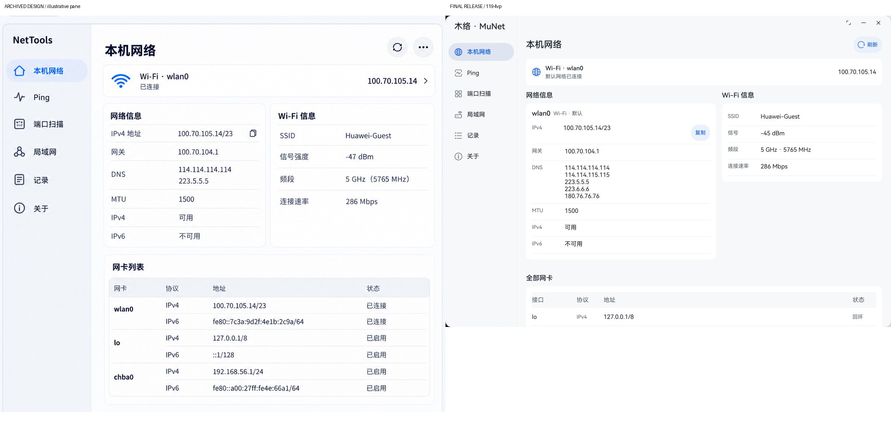
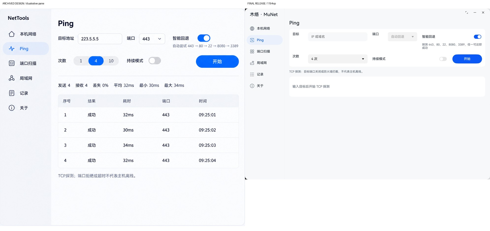
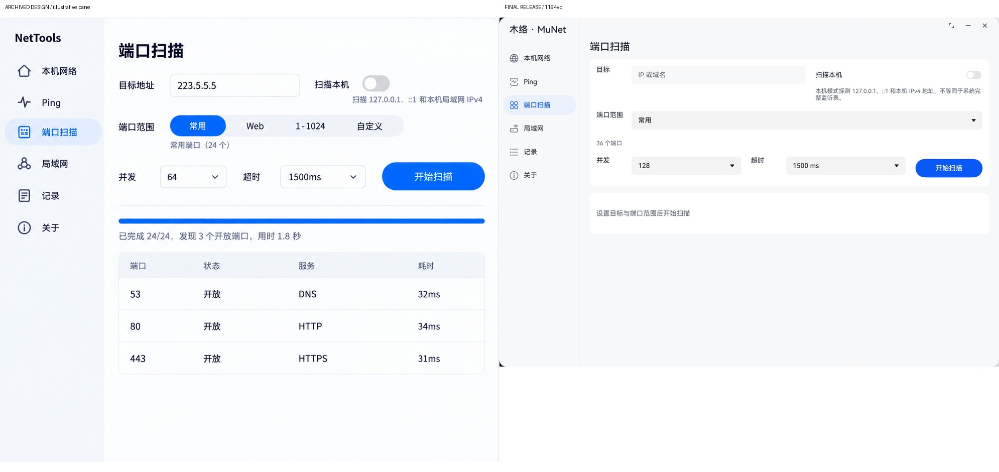
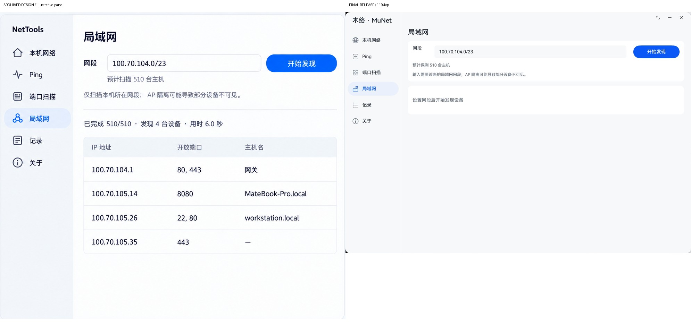
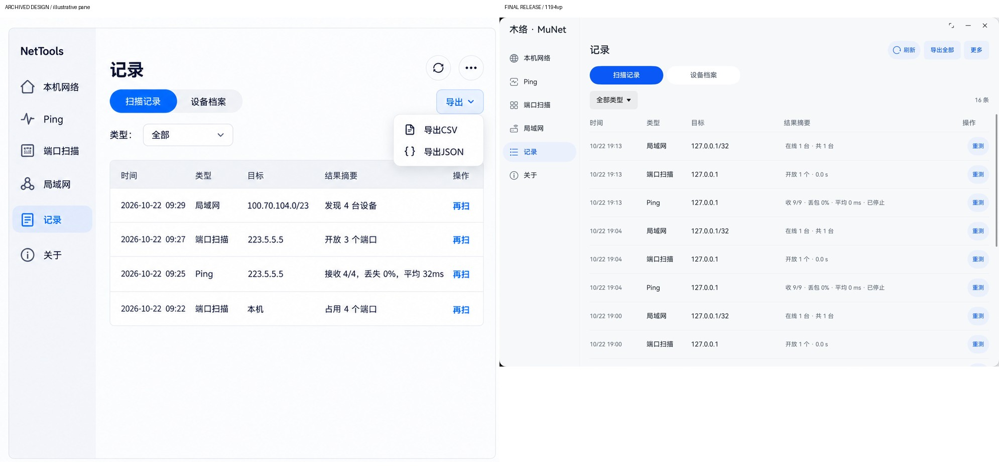
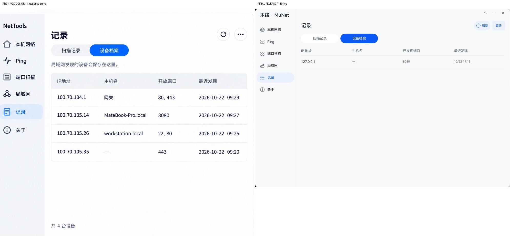
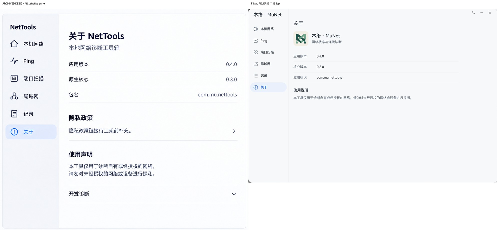

# 阶段8：严格设计对照与发布候选检查

2026-10-22。结论：PC当前实现已按设计规范及后续决定完成本轮对照，修复四类可见偏差并准备Release候选。**代码提交准备与应用市场送审准备分开：正式市场送审仍未就绪。** 发布条件见[发布准备](../../RELEASE-READINESS.md)。

## 对照依据与方法

- 归档[UI-SPEC](../../ui-redesign-2026-10-22/UI-SPEC.md)、图01–09及[后续决定](../../UI-DESIGN-UPDATES.md)。后续明确的PC侧栏、品牌、隐藏标题栏、删除隐私说明优先，不恢复图09旧顶栏或图07旧政策段落。
- 本轮重新在MateBook Pro捕获修改前及最终Release七个页面，实际窗口2269×1585px，约1194.21×834.21vp；没有用旧阶段截图代替当前审查。仅截应用窗口；曾受系统Dock遮挡的一组已拒收并重拍。
- `before-*.png`为本轮修改前截图，`after-*.png`为最终Release截图；`compare-before/after-*.jpg`将原稿宽屏画面与实机并置，已逐张查看。图册是含设备说明带的生成栅格稿，画布比例和示例数据并非精确运行状态；不以它计算像素相似度，不冒称逐像素一致。字段、字号、交互及响应式以规范正文为准。
- 端口范围和次数采用原生Select，属于规范允许的同语义原生控件；真实探测数量、地址、时间和版本不照抄示例。空态截图不能替代有结果的业务验证，后者由本轮专项实际运行核对。

## 逐页结果

| 步骤 | 页面与参照 | 当前结果与证据 |
|---|---|---|
| 1 | 本机网络／图01 | 通过本轮PC视觉检查：双列网络／Wi-Fi、下方网卡表、真实地址与复制操作；无伪详情箭头或首页自检。[对照](compare-after-home.jpg) |
| 2 | Ping／图02 | 已修正：宽窗改为两行横排参数，开始操作与次数／持续模式同行；窄窗退回单列。自动回退／持续模式禁用语义保留。[对照](compare-after-ping.jpg) |
| 3 | 端口扫描／图03 | 已修正：目标与本机开关并排，设置与主操作同排；自定义错误紧邻表达式，主操作使用原生胶囊形。[对照](compare-after-port.jpg) |
| 4 | 局域网／图04 | 已修正：宽窗网段与开始发现同行，说明和实际主机数在下方；窄窗单列。[对照](compare-after-lan.jpg) |
| 5 | 扫描记录／图05、09及PC修正 | 已修正：局部360vp分段，选中强调底＋反色字，胶囊形；大字号窄窗仍上下排，表格只对再扫提供操作。[对照](compare-after-records.jpg) |
| 6 | 设备档案／图06 | 通过本轮PC视觉检查：只显示四个信息字段，无筛选／导出／再扫；保留清空范围语义。[对照](compare-after-hosts.jpg) |
| 7 | 关于／图07及删除隐私决定 | 通过本轮Release检查：最大840vp单列、运行版本和包名；隐私段落不存在，Release诊断入口隐藏。[对照](compare-after-about.jpg) |
| 8 | 手机工具入口／图08 | 静态核对：三行原生按钮、完整名称说明、真实导航及右箭头，Ping使用连通性图标；本轮无手机／平板连接，未把PC侧栏冒充该页实机验收。末版触屏复验仍待完成。 |

另修正记录、关于、工具入口以及触屏工具返回区的中等宽度边距，采用规范的16／24vp规则；大字号提前回退、44vp点击区与系统焦点保持。

## 功能与发布模式验证

本轮桌面综合测试覆盖六档宽度六页、短高度、运行中缩放与输入保留、回环端口8080实际监听、端口／单主机发现结果、Tab／Enter／Esc菜单与焦点返回。Debug首轮及最终补丁前均15/15通过；重复同一套14项单元测试＋1项综合测试，不能相加为30项独立测试。

最终间距补丁后，另将Release主模块以设备绑定本地签名覆盖安装，运行同一专项，**15/15通过，Failure 0、Error 0**，见[最终Release结果](release-ui-tests.txt)。测试模块用于驱动验收，不包含在Release APP里。旧扫描记录与设备档案在覆盖安装后仍可读取；没有卸载应用或清空用户数据。

本轮Release实际交互截图：[短窗口](release-pc-short-ping.png)、[运行中缩窗](release-pc-narrow-ping-running.png)、[8080开放结果](release-pc-port-results.png)、[单主机发现](release-pc-lan-results.png)、[键盘焦点恢复](release-pc-keyboard-focus-return.png)、[设备档案](after-hosts.png)。测试监听在结束时关闭。自动化在点击设备档案后立即截图，画面仍停留在扫描记录，因此该截图拒收；设备档案使用另行切换并确认渲染完成的实机截图。自动化通过数不作为该次切换已完成的证据。

最终应用及APP构建见[Debug](debug-build.txt)、[Release](release-build.txt)。`scripts/check_release.py`核对产物配置、真实双ABI、字节码、权限、无测试模块与APP内运行文件一致；Debug HAP拒绝用例通过。[产物与源码SHA清单](release-manifest.json)

## 保留差异与限制

系统字体、系统符号、原生Select／Button的默认视觉与生成图稿不会逐像素一致；这里保留规范允许的原生形态，未为仿造图稿改用自绘控件。用户已经确认的品牌／导航／隐私修正保留，不当成未解决偏差。

本轮只有PC在线。手机、平板末版复验、完整屏幕朗读语音听测、正式发布签名及市场资料尚未完成。截图只能说明所见布局，不能证明完整无障碍合规或全部错误／离线状态均通过。深色与最大字号的前一轮证据仍保存在阶段7，不能改名冒充本轮末版截图。

原始设计归档与ZIP保持冻结；本文件、源码、产物清单和实际截图提供后续开发对照。

## 最终Release与设计并排图

每张图左侧为归档设计的宽屏部分，右侧为本轮Release实机；后续决定优先于原稿旧元素。

