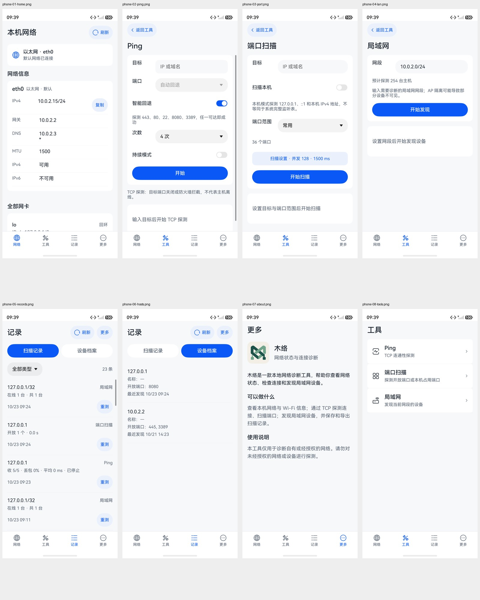
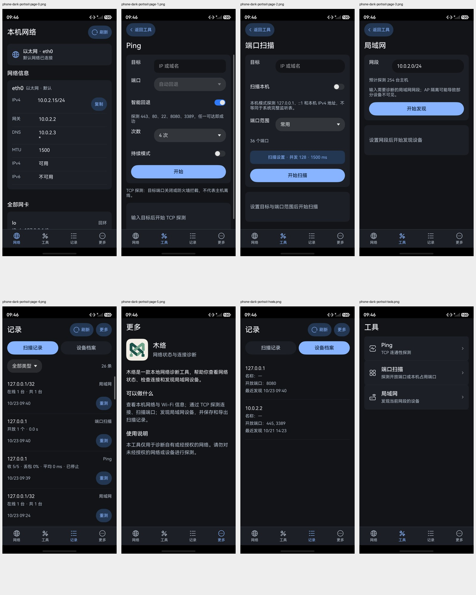
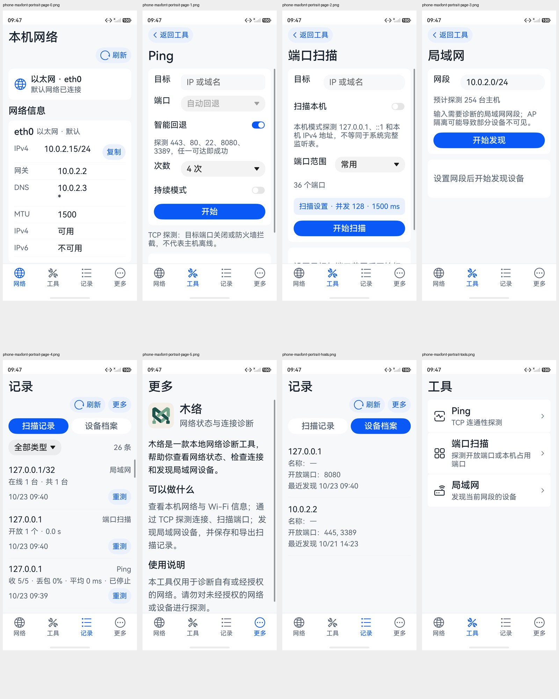
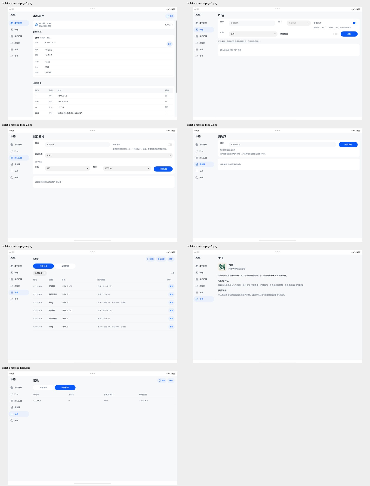
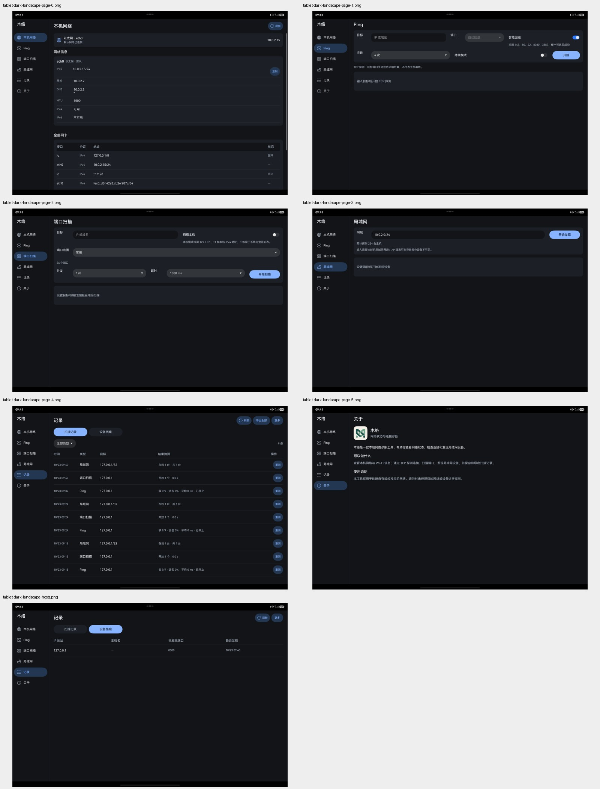
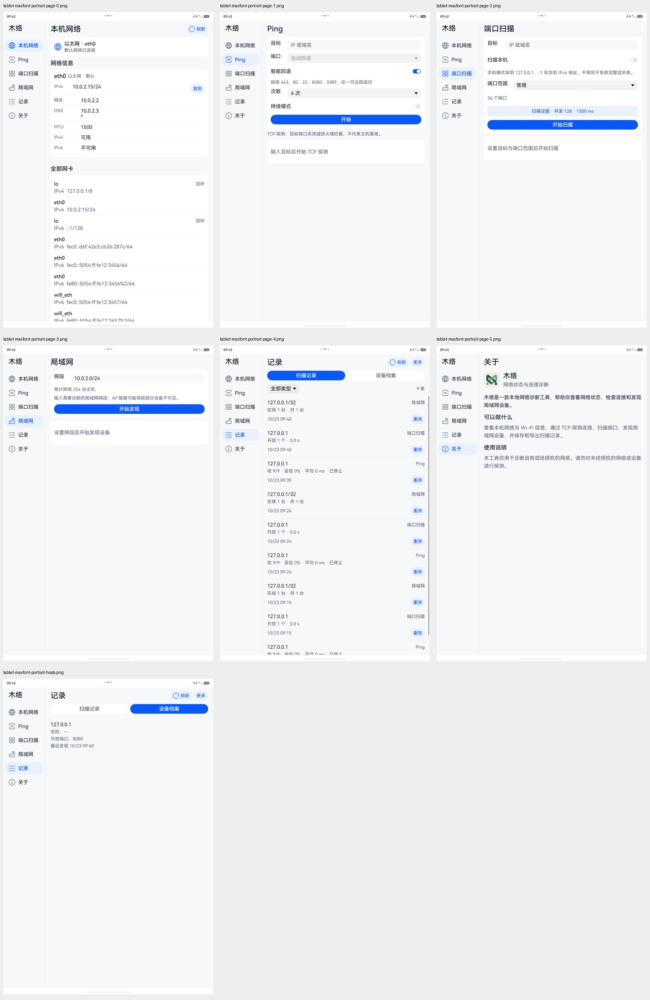
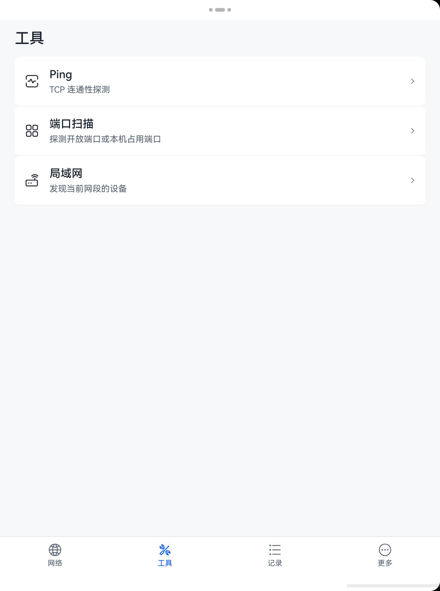

# 阶段9：手机和平板末版验收

2026-10-23。结论：本报告列明的手机竖屏、平板横竖屏／窄窗／分屏、深色、最大字体与真实回环业务检查通过。两个原有报错已查清；另修复手机操作面板点击区过小，以及窗口测试的句柄失效问题。发布候选仍需正式签名，未向市场上传。

依据：[冻结 UI-SPEC](../../ui-redesign-2026-10-22/UI-SPEC.md)、图01–09及[后续决定](../../UI-DESIGN-UPDATES.md)。本轮用户新增要求优先：首页不出现 MuNet；关于只保留基础介绍，不显示应用版本、应用标识和核心版本。原设计与 ZIP 不改写。

## 环境与证据边界

按用户指定使用模拟器，而非手机／平板真机。两台均为 HarmonyOS 6.1.1.125、API 24、x86_64，运行 `debug=false` 的 Release 主模块；测试模块单独安装，不包含在 Release APP 内。本地设备绑定签名仅用于验收。

| 环境 | 实测尺寸 | 预期与结果 |
|---|---|---|
| Pura 90 | 1320×2856px，density 3.5；内容宽约377.14vp | 四项底栏、工具入口、手机多行结果，安全区正确；不是精确390vp画布 |
| MatePad Pro 13 横屏 | 2880×1920px，density 2；内容根宽1440vp | 192vp侧栏；横排参数／宽表；关于限制阅读宽度 |
| MatePad Pro 13 竖屏 | 1920×2880px，内容根宽960vp | 因实测宽度仍≥840vp，保留侧栏；不能把它冒充834vp竖屏底栏验收 |
| 悬浮窗 | 最新专项内容根403.5×678vp | 底栏、单列、参数保留、开始按钮可达；请求320／390／600／834／1194／1440均受系统限宽，不算六档精确覆盖 |
| 左右分屏 | 应用窗口1432×1920px，宽716vp | 四项底栏、工具入口和单列；恢复1440vp全屏后目标127.0.0.1保留，侧栏恢复 |
| 最大字体 | 系统字体大小第5档“特大”；字重1、显示大小1保持默认 | 页面与操作可阅读；记录页页头换行，参数／列表提前回退，手机操作面板各项至少56vp |

本轮截图均重新采集并查看。分屏首次教学遮挡的一张已拒收并重拍；输入法初始化图只作失败原因证据，不作页面验收截图。窗口测试截图按日志中的应用根边界裁取，分屏只裁取木络窗口。部分截图采集于本轮较早补丁；渲染未变的页面保留，受手机面板及Ping断点修复影响的画面重新采集，不将已知省略状态留作最终证据。

## 逐页设计对照

| 步骤 | 页面 | 结论与证据 |
|---|---|---|
| 1 | 本机网络／图01 | 通过。手机信息单列，平板网卡表按实际空间切换；模拟器只有以太网，未伪造Wi-Fi卡。首页和侧栏无 MuNet。[手机](phone-01-home.png)／[平板](tablet-landscape-page-0.png) |
| 2 | Ping／图02 | 通过。手机多行结果，平板表格；真实回环服务有接收记录，停止后保留；运行中横竖屏切换不断任务、不丢目标。[手机结果](phone-13-ping-results.png)／[旋转中](tablet-rotation-running.png)／[平板结果](tablet-ping-results.png) |
| 3 | 端口扫描／图03 | 通过。手机扫描设置折叠、两行结果；平板横排参数；实际检测8080开放。软键盘显示时内容缩短，开始与结果可访问。[手机](phone-10-port-results.png)／[平板及键盘](tablet-port-results.png) |
| 4 | 局域网／图04 | 通过。输入127.0.0.1/32实际探测1台并发现8080，手机多行、平板三列，未知主机名为—。[手机](phone-11-lan-results.png)／[平板](tablet-lan-results.png) |
| 5 | 扫描记录／图05、09 | 通过。手机记录分行、局部分段；宽屏表格和导出菜单。手机面板修正点击区，标准／最大字体均断言按钮高度≥56vp。[标准面板](phone-15-records-actions.png)／[最大字体面板](phone-maxfont-records-actions.png)／[深色面板](phone-dark-records-actions.png) |
| 6 | 设备档案／图06 | 通过。手机标签分行、宽屏四列；无类型筛选、导出和再扫。清空确认明确同时删除记录与档案，取消后数据保留。[手机](phone-12-hosts-results.png)／[平板](tablet-hosts-results.png)／[取消确认](phone-14-clear-confirm.png) |
| 7 | 更多／关于／图07及新增要求 | 通过。改为木络介绍、功能说明及使用说明；版本／标识／核心版本均移除，隐私段落未恢复，Release诊断入口不存在。[手机](phone-07-about.png)／[平板](tablet-landscape-page-5.png) |
| 8 | 工具入口／图08 | 通过。三行原生按钮、连通性Ping图标、真实导航和返回；宽屏直接进入工具，分屏回到工具页。[手机](phone-08-tools.png)／[716vp分屏](tablet-split-tools.png) |

生成图稿的外框与说明带不是应用元素；文字内容、原生控件和后续决定优先，不宣称逐像素一致。地址、时间、端口数均为实际数据，不能照抄图稿示例。

## 报错原因与修复

1. **手机找不到导出JSON**：清空确认取消后，脚本过早点击页签，弹窗尚未消失；增加等待，并给手机“更多”增加明确ID。最终完整专项15/15通过。进一步实际点击发现原生ActionSheet的三项操作被压成不足44vp，已改为系统底部Sheet＋原生Button：至少56vp、文字可换行、内容可滚动，关闭完成后再执行清空或导出。[修复前](phone-actions-before.jpeg)／[修复后](phone-15-records-actions.png)。
2. **平板找不到Ping内容区**：首次输入触发系统小艺输入法初始化，遮住应用；失败现场[初始化弹窗](tablet-failure.png)。选择本地基本输入模式并完成键盘布局初始化后重跑通过，没有给木络增加输入法所列的通讯录／相机等权限。测试补输入前后截图与失败阶段，避免把系统遮挡误判为应用页面消失。
3. **追加窗口专项报错**：模拟器的聚焦窗口过滤不稳定，旋转后缓存的UiWindow也会失效。改用应用包名查找、空值检查，旋转／缩放前重新取得窗口；不再无条件按返回键误离开工具，结束后恢复窗口模式。最终窗口专项15/15通过。

4. **平板竖屏Ping端口值省略**：内容区仅768vp时三列参数过窄，“自动回退”被原生Select省略。参数横排阈值独立提高到960vp并随字号增加，结果表格保持原规则；增加端口选择框宽度≥120vp的布局断言，修复后重新检查横竖屏及业务。

## 构建、交互与数据

| 最终检查 | 结果 |
|---|---|
| Release APP与测试模块构建 | 通过，见[Release日志](release-build.txt)和[测试模块日志](test-build.txt) |
| 手机完整专项 | **15/15，Failure 0、Error 0**：[日志](phone-release-tests.txt) |
| 平板完整专项 | **15/15，Failure 0、Error 0**：[日志](tablet-release-tests.txt) |
| 平板悬浮窗专项 | **15/15，Failure 0、Error 0**：[日志](tablet-window-tests.txt) |
| 手机深色／最大字体专项 | 各15/15：[深色](phone-dark-tests.txt)／[最大字体](phone-maxfont-tests.txt) |
| 平板深色／最大字体专项 | 各15/15：[深色](tablet-dark-tests.txt)／[最大字体](tablet-maxfont-tests.txt) |
| 新面板实际导出交接 | JSON调起系统保存器；返回取消后仍有23条记录，无成功提示，见[保存器](phone-export-picker.jpeg)。本轮没有再次写入CSV／JSON文件，不能把历史写入结果说成本轮结果 |
| 左右分屏与恢复 | 716vp工具／Ping正常；恢复全屏仍有127.0.0.1，见[分屏Ping](tablet-split-ping.png)和[恢复全屏](tablet-restored-ping.jpeg) |
| Release产物检查 | 配置、三项权限、真实双ABI、字节码、无测试模块、APP内运行文件一致；见[SHA与源码清单](release-manifest.json) |

每批都重复同一组14项单元测试＋1项专项，不能相加声称105项独立测试。综合用例临时监听127.0.0.1:8080并在结束时关闭；会增加回环记录，没有卸载应用或清空用户数据。破坏性清空使用隔离仓库单元测试，实际设备只验证确认和取消。

复现：新模拟器先完成输入法基本模式与键盘布局初始化。签名安装本轮Release主模块与独立entry_test后，运行 `aa test -b com.mu.nettools -m entry_test -s unittest OpenHarmonyTestRunner -s touchAcceptance 1 -s timeout 300000`。主题检查另传 `-s touchVisualOnly 1 -s capturePrefix dark-` 或 `maxfont-`，并先在系统设置实际切换。窗口专项改为 `-s windowAcceptance 1`。默认单元测试不操作设备界面。

## 归档与限制

截图、日志、接口／权限证据和源码对应SHA随本目录归档；原始设计ZIP保持冻结。当前权限及拟申请扩展用途见[权限申请清单](../../PERMISSIONS.md)，候选包位置与正式签名条件见[发布准备](../../RELEASE-READINESS.md)。两端已恢复浅色、标准字体2、字重1、显示大小1；平板恢复全屏。

本轮完成列明的模拟器UI与业务验收，不能代替真实Wi-Fi／真实局域网兼容性、完整读屏语音听辨或正式市场签名包的验证。没有从截图推断无障碍全面合规。模拟器无有效音频采集设备，完整语音听测仍需人工／实机；不将旧阶段读屏操作改名成本轮听测。正式签名与市场材料未完成。

## 最终画面

手机八页设计并排对照：[首页](compare-phone-home.jpg)、[Ping](compare-phone-ping.jpg)、[端口](compare-phone-port.jpg)、[局域网](compare-phone-lan.jpg)、[记录](compare-phone-records.jpg)、[档案](compare-phone-hosts.jpg)、[关于](compare-phone-about.jpg)、[工具](compare-phone-tools.jpg)。关于按本轮要求简化，图稿旧版本字段不恢复。

